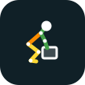
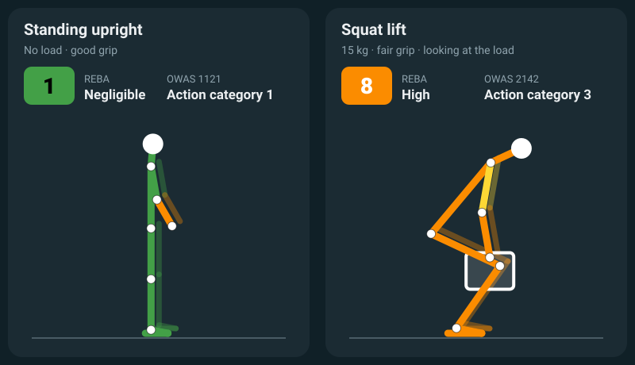
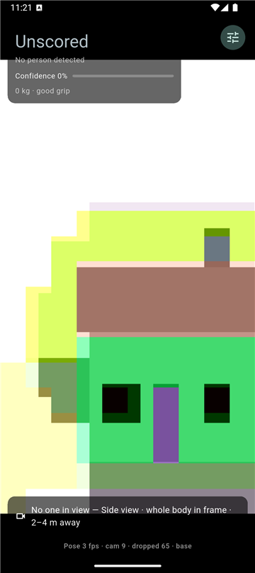
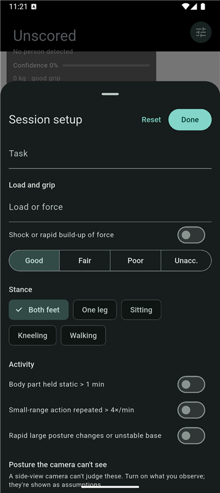
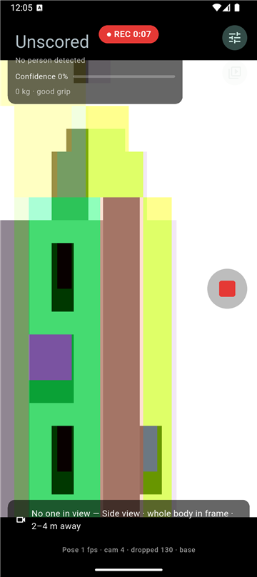
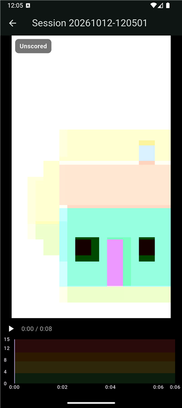
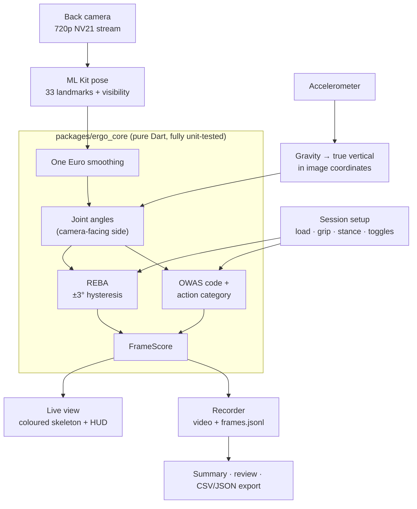
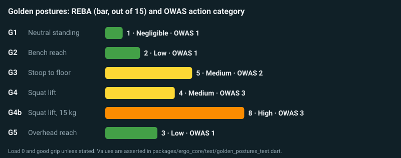
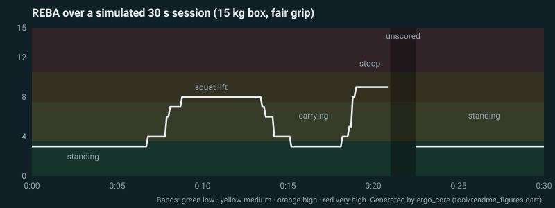
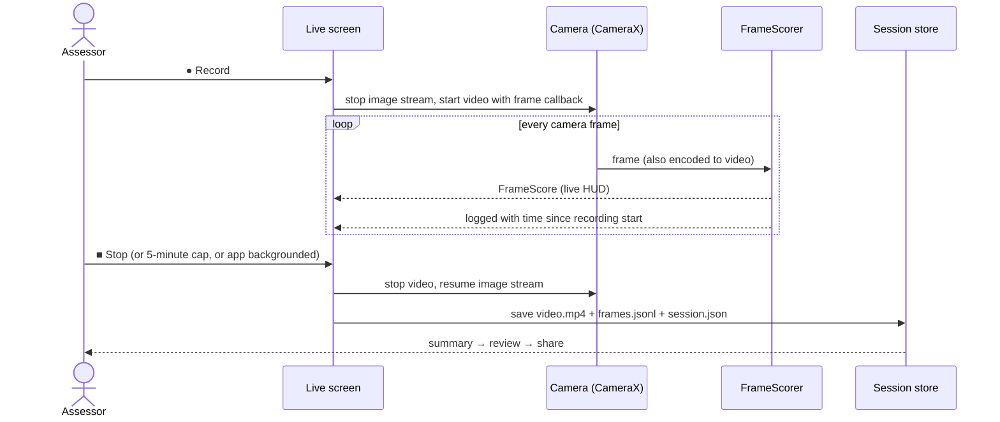

<p align="center">
  
</p>

<h1 align="center">ErgoCam</h1>

<p align="center">
  <b>Live ergonomic posture scoring from a phone camera.</b><br>
  Point a phone at a worker from the side and get a REBA and OWAS assessment, frame by frame,
  on the device, with a risk-coloured skeleton, a recording, a summary and an export.
</p>

<p align="center">
  Flutter · on-device ML Kit pose (BlazePose) · pure-Dart scoring engine · Android 16+ (Pixel 10 and newer)
</p>

---



*Figures in this README are produced by the real scoring engine from simulated poses
([`tool/readme_figures.dart`](packages/ergo_core/tool/readme_figures.dart)); the scores are exactly what the app computes.*

## What it does

Manual posture assessments are slow: an assessor watches a task, freezes on the worst moment
and fills in a REBA or OWAS sheet by hand. ErgoCam does the measuring part continuously:

- **Watches** a worker through the phone's back camera and tracks 33 body landmarks with
  Google ML Kit pose detection, entirely on the phone.
- **Measures** trunk, neck, upper-arm, elbow and knee angles from a side view, using the
  phone's accelerometer as true vertical so a tilted phone doesn't look like a bent back.
- **Scores** every frame with **REBA** (Rapid Entire Body Assessment, 1–15) and **OWAS**
  (Ovako Working posture Analysing System, action category 1–4), live, at 15+ frames per second.
- **Shows** the result on the camera view: the skeleton is coloured green → red per body region,
  with the REBA score, risk band, OWAS code and a confidence meter.
- **Records** sessions (video + a per-frame score log), then **summarises** them (max, 90th
  percentile, mean, share of high-risk time), lets you **review** the video with the skeleton
  redrawn on it, and **exports** CSV/JSON through the share sheet.

It is an internal demo of what continuous, camera-based assessment could look like. It is not a
replacement for a trained ergonomist (see [Accuracy and limits](#accuracy-and-limits)).

## Screens

| Live view | Session setup | Recording | Review |
|---|---|---|---|
|  |  |  |  |
| Score panel, placement hints, record button | Load, grip, stance, activity and what 2D can't see | `● REC` clock; scoring continues while recording | Video with the skeleton redrawn from the log, scrubbable timeline |

*These screenshots come from the Android emulator, whose virtual camera shows a test scene with no
person in it, so frames read "Unscored". On a phone pointed at a person you get the risk-coloured
skeleton and live scores shown in the figure above.*

## How it works



- **Pose** runs in ML Kit's native background executor; the app drops camera frames while a
  detection is in flight, so nothing queues up and latency stays flat.
- **All scoring lives in [`packages/ergo_core`](packages/ergo_core)**, a pure Dart package with no
  Flutter imports. The UI only displays results. The whole pipeline (smoothing → angles → REBA →
  OWAS → region colours) is one testable step, `FrameScorer`.
- **Frames are never guessed.** A frame is scored only when every landmark it needs (near-side
  shoulder, elbow, wrist, hip, knee, ankle and ear) passes the 0.5 visibility threshold and the
  facing direction is known. Otherwise it shows **Unscored** with the reason, never a number.

## Scoring

### REBA

REBA scores the trunk, neck and legs (Group A) and the upper arm, lower arm and wrist (Group B),
combines them through Tables A, B and C, and adds load, grip (coupling) and activity. The tables
are transcribed in [`docs/SCORING.md`](docs/SCORING.md) from Hignett & McAtamney (2000), and a test
re-reads that document and checks every cell of the Dart copy.

| REBA score | Risk band |
|---|---|
| 1 | Negligible |
| 2–3 | Low |
| 4–7 | Medium |
| 8–10 | High |
| 11–15 | Very high |

On the skeleton, each region (trunk, neck, legs, and each upper arm and forearm) is coloured by
its own sub-score, placed within that region's range: 🟩 its lowest score, 🟨 one step up,
🟧 two steps up, 🟥 its worst range. Grey means the frame is unscored or that limb wasn't
measured. The exact mapping is in [`docs/SCORING.md`](docs/SCORING.md#region-colours-display-only).

Things a side-view 2D camera can't judge reliably (trunk or neck twist and side bend, wrist angle,
arm abduction, raised shoulders, standing on one leg, sitting, kneeling, walking) are **manual
toggles** in the setup sheet. They are shown on screen as *Assumed: …* so nobody mistakes them for
measurements.

### OWAS

OWAS codes the back, arms, legs and load as four digits (e.g. `2142`) and maps each of the 252
combinations to an action category: 1 no action, 2 correct soon, 3 correct as soon as possible,
4 correct immediately. The table was transcribed from published reproductions that agree on all
252 cells, cited in [`docs/SCORING.md`](docs/SCORING.md) along with one row that a fourth source
disputes.

### Golden postures

Reference postures with hand-derived scores are part of the test suite. Neutral standing must
never score above 3.



Without a load, REBA rates even a deep squat as medium. It's the load, grip and activity that push
a real lift into the high band, which is why the session setup matters.

## Recording, summary and export



A recording saves the video and every frame's score. When it stops, a summary opens. For the
simulated session above, the engine reports:

| Metric | Value | | Metric | Value |
|---|---|---|---|---|
| REBA max | **9** (at 0:19, the stoop) | | OWAS max category | **3** |
| REBA P90 | **8** | | OWAS mean | 1.6 |
| REBA mean | 4.6 | | Frames at OWAS ≥ 3 | 22% |
| Frames at REBA ≥ 8 | **24%** | | Frames scored | 95% |

Stats use scored frames only; the unscored share is reported next to them so gaps aren't hidden.
P90 uses the nearest-rank method.



Each session is one self-contained folder in the app's private storage:

```
sessions/20261012-143005/
├── session.json   task, setup, summary, ergo_core version
├── frames.jsonl   one frame per line: landmarks, angles, REBA/OWAS sub-scores
├── video.mp4      camera-only (no audio)
└── frames.csv     written when you export
```

**Share data** sends `session.json`, `frames.csv` and `frames.jsonl`; **Share video** sends the
MP4. Both go through the Android share sheet, so they can be emailed or saved to Drive.

## Accuracy and limits

- **2D, side view.** Angles come from a single camera. They're reliable for flexion in the plane
  the camera sees, and unreliable for anything out of that plane, hence the manual toggles.
  Placement matters: side-on, whole body in frame, 2–4 m away. The app shows hints when framing
  is poor.
- **Thresholds have ±3° hysteresis** so scores don't flicker, and "upright" means within ±5°.
  These display and stability choices are documented in [`docs/SCORING.md`](docs/SCORING.md).
- **One person.** ML Kit tracks the most prominent person in view.
- **Not a certified instrument.** Treat the output as a screening aid that shows where to look,
  not as a formal assessment. The REBA tables should be checked against the original paper
  before any real use, and one OWAS row is flagged as disputed between sources.

## Privacy

- Pose detection runs on the phone. **Camera frames are never uploaded.**
- Nothing is saved unless you press record; recordings stay in the app's private storage until
  you share or delete them.
- The camera is used without audio. The app requests no microphone permission.
- Google ML Kit's libraries make their own network calls (usage statistics and remote
  configuration). They don't send images.

## Getting started

**Just want to try it?** Download the APK from the
[latest release](https://github.com/droidment/ergo-cam/releases) on an Android 16+ phone and
install it (allow installs from your browser or Files app when asked).

**To build it yourself:**

You need Flutter 3.47+ (Dart 3.13), the Android SDK, and an Android 16+ phone with a camera.
Pixel 10 or newer is the primary target. iOS compiles but is untested.

```bash
git clone https://github.com/droidment/ergo-cam.git
cd ergo-cam/app
flutter pub get
flutter run --release          # phone connected over USB
```

Or build an APK to sideload:

```bash
flutter build apk --release --split-per-abi --target-platform android-arm64
# → app/build/app/outputs/flutter-apk/app-arm64-v8a-release.apk
```

Tests:

```bash
cd packages/ergo_core && dart test     # scoring engine: tables, rules, goldens, pipeline
cd app && flutter test && flutter analyze
```

Regenerate the README figures:

```bash
cd packages/ergo_core && dart run tool/readme_figures.dart ../../docs/images
```

## Project layout

```
app/                     Flutter app: camera, pose, live UI, recording, sessions
  lib/features/live/       camera view, skeleton painter, HUD
  lib/features/session/    setup sheet, summary, review, session list, timeline chart
  lib/services/            pose (ML Kit), gravity, framing hints, session store
  lib/providers/           Riverpod state: live session, setup, sessions
packages/ergo_core/      Pure Dart scoring engine (no Flutter)
  lib/src/                 angles, One Euro filter, REBA, OWAS, FrameScorer, stats, JSON/CSV
  test/                    265 tests, including golden postures (the app adds 62)
docs/
  PLAN.md                  phases and acceptance criteria
  ARCHITECTURE.md          modules, data flow, wire format, storage
  SCORING.md               REBA/OWAS rules and tables, sources, decisions
```

## Status

| Phase | | |
|---|---|---|
| 0 · Scaffold | ✅ | Verified on Pixel 11 |
| 1 · Live camera + pose overlay | ✅ | 15+ FPS, portrait and landscape |
| 2 · Angles + scoring engine | ✅ | REBA + OWAS, all tables tested |
| 3 · Live scoring UI | ✅ | Standing REBA 1, loaded squat REBA 8, live |
| 4 · Record, summarise, export | 🔶 | Built and emulator-tested; on-device check pending |
| 5 · Live stream to a laptop dashboard | ⬜ | Planned |

Later: uploading sessions to Google storage, multi-person tracking, the NIOSH lifting equation,
RULA. See [`docs/PLAN.md`](docs/PLAN.md).

## References

- Hignett, S. & McAtamney, L. (2000). Rapid Entire Body Assessment (REBA). *Applied Ergonomics*, 31(2), 201–205.
- Karhu, O., Kansi, P. & Kuorinka, I. (1977). Correcting working postures in industry: A practical method for analysis. *Applied Ergonomics*, 8(4), 199–201.
- Casiez, G., Roussel, N. & Vogel, D. (2012). 1€ Filter: A simple speed-based low-pass filter for noisy input in interactive systems. *CHI '12*.
- OWAS action-category table sources: see [`docs/SCORING.md`](docs/SCORING.md#owas-action-category-table).

## Development

This project is built phase by phase with [Claude Code](https://claude.com/claude-code).
[`CLAUDE.md`](CLAUDE.md) holds the project rules (scoring only in `ergo_core`, no invented table
values, a test for every scoring change, privacy). Two slash commands drive the work:
`/next-phase` plans the next unchecked phase in `docs/PLAN.md`, and `/verify-scoring` runs the
engine tests and walks the golden postures.

## License

[BSD 3-Clause](LICENSE). Third-party components keep their own licenses; in particular, Google
ML Kit is used under the [ML Kit terms](https://developers.google.com/ml-kit/terms).
